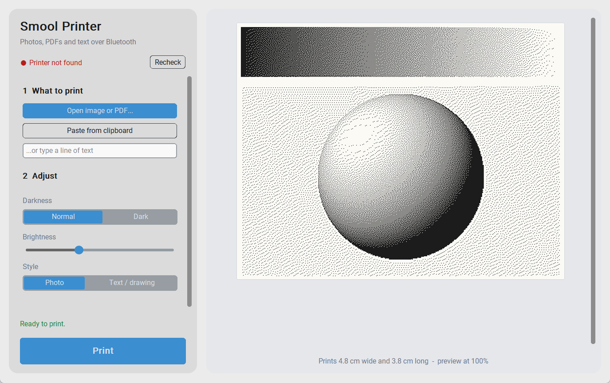

# Smool Printer

A small Windows desktop app that prints images, PDFs (first page), pasted images and text on a
58mm Bluetooth thermal printer (F2 family) over **Bluetooth LE**, from the PC.

Unofficial and not affiliated with the printer's maker.



## Run

```
pip install pillow bleak pymupdf customtkinter tkinterdnd2
python nanox_app.py        # or double-click print.bat
```

Switch the printer on and close the printer's phone app first: the printer only advertises
when nothing else is connected. The app finds it by name (`F2...`).

CLI: `python nanox.py pic.png --out job.bin --preview preview.png` (dry run), or
`python nanox.py --text "Hello" --ble auto` to print.

## Limits

Only this printer family is supported. Text is a single line; PDFs print page 1 only.
Windows only (font path and `print.bat`).

Tests: `python -c "import test_nanox as t; [getattr(t, n)() for n in dir(t) if n.startswith('test_')]"`
